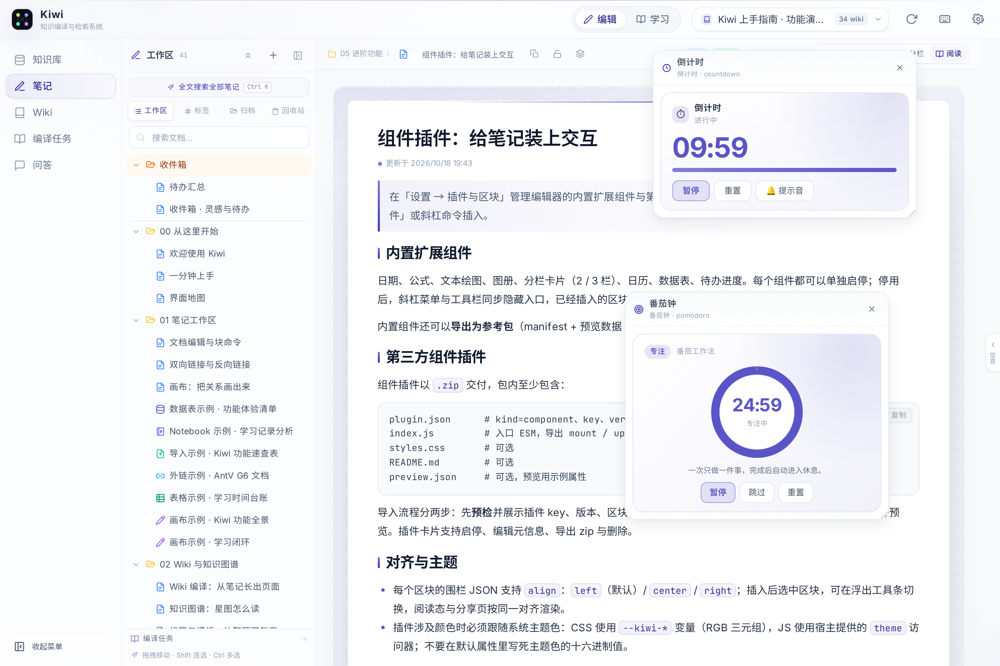
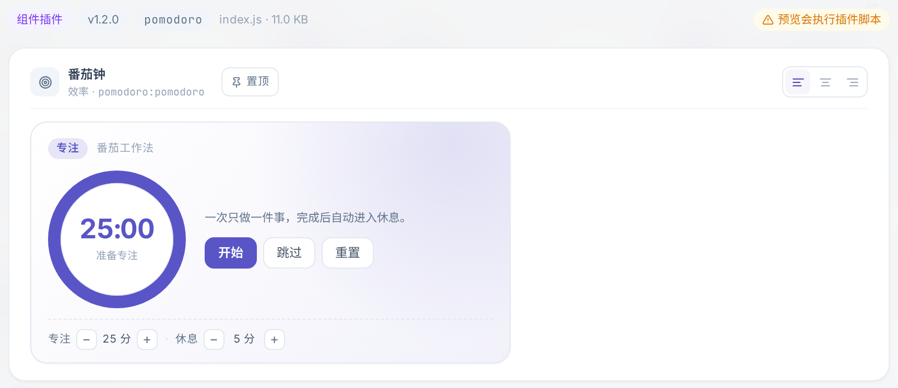
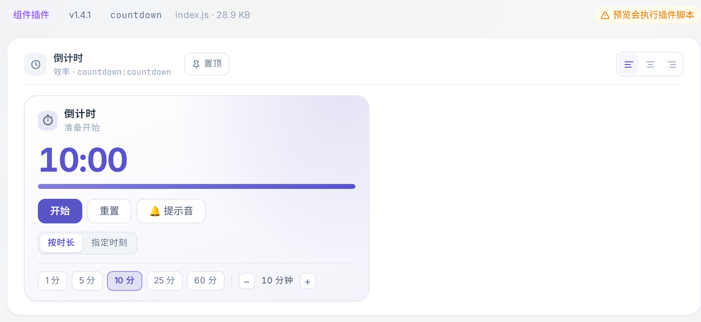
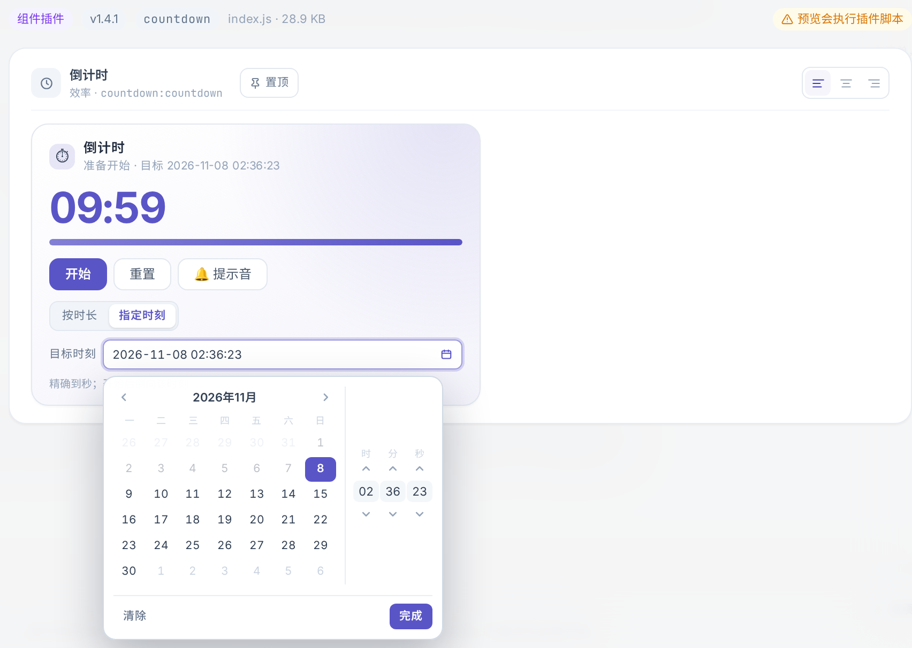

<h1 align="center">Kiwi Plugins</h1>

<p align="center">
  A maintained collection of plugins and themes for Kiwi.<br />
  Component plugins for the editor plus full-interface theme plugins.<br />
  <a href="README.zh-CN.md">简体中文</a> · <strong>English</strong>
</p>

<p align="center">
  
</p>

<p align="center">
  
  
  
  
</p>

---

Kiwi component plugins add interactive blocks to Kiwi's editor. A plugin is a zip
containing a manifest and a single-file browser ESM; Kiwi loads it only after the user
imports and enables it. This repository is the long-term home for component plugins and
theme plugins maintained outside the main Kiwi repository, with shared validation,
packaging, versioning, release notes, and documentation.

It currently ships **Pomodoro**, **Countdown**, and **Timeline**, plus the **Grand Line**,
**Ink Dusk**, **Neon Hush**, **Pixel Huddle**, and **Sunny Meadow** themes. The two timer blocks
declare `pinnable: true`, so they can be placed in a global floating window from the
plugin card, the preview dialog, the editor toolbar, or the `Ctrl / ⌘ + K` command
palette — **without creating or inserting a note first**. The timer keeps running across
routes and page reloads while the window stays open. Timeline is an embedded block that
stays in the note.

More plugins will be added under `plugins/` using the same contract. Pinning is
per-block, not per-repository: embedded blocks such as column cards can stay
insert-only.

## Plugins

| Plugin | Key | Block | What it does | Global pinning |
|---|---|---|---|---|
| Pomodoro 番茄钟 | `pomodoro` | `pomodoro` | 25 min focus / 5 min break cycle, pause, skip, reset, completed-round count, adjustable durations | Yes |
| Countdown 倒计时 | `countdown` | `countdown` | Duration mode with presets (1 / 5 / 10 / 25 / 60 min) or a target date-time to the second; end sound, completion count | Yes |
| Timeline 时间轴 | `timeline` | `timeline` | Vertical timeline; each point expands into rich-text notes (including task checkboxes) with a collapsed summary, key-point highlighting, add / delete | No |

Both timers persist their running state with an absolute `endsAt` timestamp, so closing
the note or refreshing the page does not restart them. They only write props on state
changes (start / pause / reset / finish), not every second, so Kiwi's autosave is not
flooded. Timeline keeps its points in `props.points` and only writes on edits,
expand / collapse is local UI state. Point content is stored as Markdown and uses the
host-provided `host.components.NoteEditor` rich-text editor.

## Themes

Theme plugins are declarative JSON + CSS packages that reskin the whole Kiwi interface:
colors, background image / video, surface opacity and blur, typography, and scoped
decorations. They never execute JavaScript. Install one from **Settings → Themes →
Import theme**.

| Theme | Key | Mode | What it does | Version |
|---|---|---|---|---|
| 伟大航路 Grand Line | `grand-line` | Light | One Piece "WANTED" newspaper: looping background video, bundled Bangers / Pirata One fonts, Straw Hat Jolly Roger, compass-rose watermarks, full component coverage | 1.0.4 |
| 墨霞 Ink Dusk | `ink-dusk` | Light | Ink-wash sunset wallpaper with rice-paper surfaces, cinnabar accent, gilded hairlines, and serif typography | 1.0.0 |
| 霓虹禁语 Neon Hush | `neon-hush` | Dark | Cyberpunk terminal: 2560×1440 looping background video, magenta / cyan neon, deep-glass panels | 1.1.0 |
| 例会 Pixel Huddle | `pixel-huddle` | Light | Pixel-art meeting room with cream grid paper, charcoal outlines, and an orange-red accent | 1.0.4 |
| 晴野 Sunny Meadow | `sunny-meadow` | Light | Japanese healing landscape: clear sky, flower fields and snow peaks behind soft glass panels | 1.0.3 |

Theme sources live under `themes/<key>/` (`plugin.json` + `theme.css` + `assets/`); the
same packaging script validates and builds `dist/<key>-<version>.zip`. The complete
specification is [Kiwi's `docs/THEME_SPEC.md`](https://github.com/LsWGG/Kiwi/blob/main/docs/THEME_SPEC.md).

## Interface

<table>
  <tr>
    <td width="50%"><br /><sub>Pomodoro: focus / break cycle with adjustable durations</sub></td>
    <td width="50%"><br /><sub>Countdown: duration presets, ±1 minute tuning, and end sound</sub></td>
  </tr>
</table>

<p align="center">
  
</p>

<p align="center"><sub>Target time: a self-drawn calendar and second-level steppers that follow the theme — no native browser date popup.</sub></p>

## Requirements

- Kiwi `1.0.0` or newer with **component plugin** support (`kind: "component"`).
- A Kiwi build that understands the manifest `pinnable` field. Older builds simply
  ignore the field and keep the block insert-only.
- Rich-text timeline content requires a Kiwi build with `host.components.NoteEditor`;
  older builds automatically fall back to a plain textarea.
- `zip` and Node.js 18+ only if you want to rebuild the packages locally.

## Install

1. Download or build `dist/pomodoro-1.2.0.zip` / `dist/countdown-1.4.1.zip` / `dist/timeline-1.2.0.zip`.
2. Open **Kiwi → Settings → Plugins & Blocks → Import plugin** and select the zip.
3. Enable the plugin.
4. Insert with `/番茄钟` or `/倒计时`, or pin it directly from the plugin card / preview
   dialog / `Ctrl / ⌘ + K` command palette.

Importing the same key again with the same or a newer version updates the plugin in
place and preserves its enabled state.

Themes use a separate entry: **Kiwi → Settings → Themes → Import theme**, then enable
the theme card. For example, `dist/grand-line-1.0.4.zip` or `dist/ink-dusk-1.0.0.zip`.

## Project layout

```
kiwi-timer-plugins/
├── plugins/
│   ├── pomodoro/          # plugin.json, index.js, style.css, README.md
│   └── countdown/
├── themes/
│   ├── grand-line/        # plugin.json, theme.css, assets/, README.md
│   └── ink-dusk/
├── docs/
│   ├── assets/screenshots/
│   ├── DEVELOPMENT.md     # runtime contract and implementation notes
│   └── RELEASING.md       # versioning, packaging, release checklist
├── scripts/package.mjs    # validate manifests + build installable zips
├── CHANGELOG.md
└── package.json
```

## Development

There is no bundler step: `index.js` is a single-file browser ESM that exports
`setup(host)`. Edit the source, validate, package, then import the zip into Kiwi.

```bash
npm run validate   # check manifest fields and file limits
npm run package    # build dist/<key>-<version>.zip for every plugin and theme
```

The packaging script discovers every directory under `plugins/` and `themes/`, so a new
plugin is just a new `plugin.json` + `index.js` (plus optional `style.css` / `README.md`),
and a new theme is a `plugin.json` + `theme.css` + `assets/`. Package rules enforced by
the script and by Kiwi:

- `plugin.json`, `index.js`, `style.css`, and `README.md` sit at the zip root.
- Entry script ≤ 2 MB, style ≤ 512 KB, whole package ≤ 5 MB.
- `key` matches `^[a-z0-9][a-z0-9-]{1,63}$` and stays stable after installation.
- The two timer blocks keep `pinnable: true`, and the validation script enforces it for
  `pomodoro` / `countdown`; new plugins opt in per block.

See [docs/DEVELOPMENT.md](docs/DEVELOPMENT.md) for the host contract, prop persistence,
theme variables, and pinning behavior. The upstream specification is
[Kiwi's `docs/PLUGIN_SPEC.md`](https://github.com/LsWGG/Kiwi/blob/main/docs/PLUGIN_SPEC.md).

## Versioning

Each plugin keeps its own manifest version; the root `package.json`, Git tag, and
GitHub release track the repository release. Semantic versioning (see
[CHANGELOG.md](CHANGELOG.md)):

- **Major** — a change that breaks saved `default_props` or the block contract.
- **Minor** — new user-visible capability (for example, adding `pinnable`).
- **Patch** — backwards-compatible fixes.

Release archives are named `<key>-<version>.zip` under `dist/` and are meant to be
attached to the matching Git tag / GitHub release.

## Security

A Kiwi component plugin is third-party code that runs in the browser after a user
imports and enables it. It can read data available to the current page. Install only
plugins from sources you trust. Kiwi does not execute plugin scripts on the server, and
public share pages do not load plugin runtimes.

## License

Copyright © 2026 LsWGG. All rights reserved. See [LICENSE](LICENSE).
