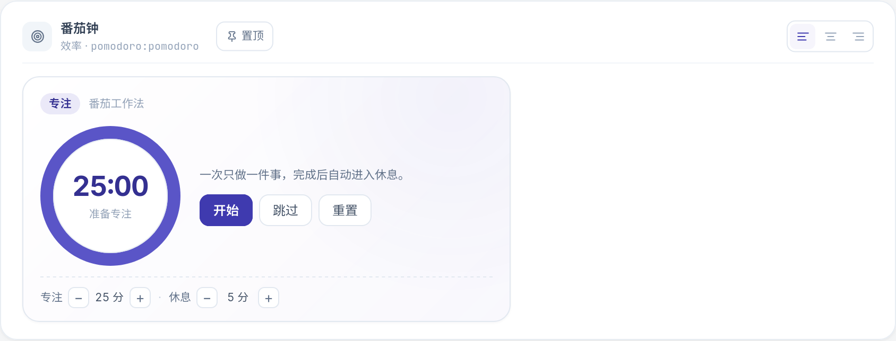
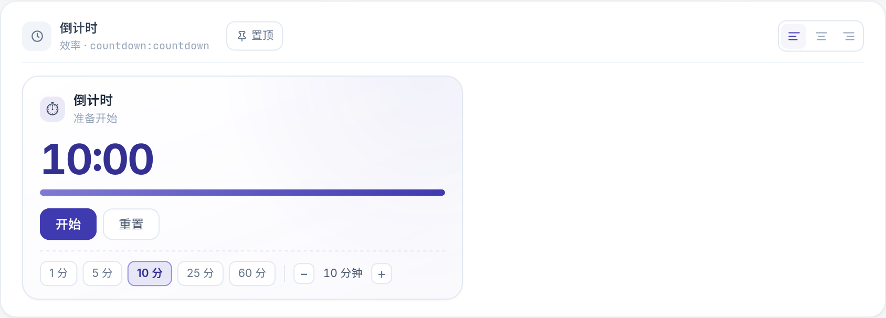

<h1 align="center">Kiwi 组件插件</h1>

<p align="center">
  面向 Kiwi 的组件插件集合。<br />
  目前提供番茄钟与倒计时，后续持续扩展新插件。<br />
  <strong>简体中文</strong> · <a href="README.md">English</a>
</p>

<p align="center">
  
</p>

<p align="center">
  
  
  
  
</p>

---

组件插件为 Kiwi 编辑器增加可交互区块。插件以 zip 交付，包内包含 manifest 与单文件
浏览器 ESM；只有用户主动导入并启用后，Kiwi 才会在浏览器中加载执行。本仓库是这些
组件插件的长期维护入口，统一提供校验、打包、版本、发布记录与文档。

当前提供**番茄钟**与**倒计时**两个插件，两个区块都声明了 `pinnable: true`，因此可以
从插件卡片、预览弹窗、编辑器区块工具条或 `Ctrl / ⌘ + K` 命令面板直接置顶为全局浮窗，
**不需要先创建或插入笔记**；切换路由、刷新页面后计时继续。

后续新插件会继续放在 `plugins/` 下，沿用同一套契约。置顶是**区块级**能力，不是仓库级
承诺：分栏卡片等嵌入正文的区块可以保持仅插入形态。

## 插件

| 插件 | Key | 区块 | 能力 | 全局置顶 |
|---|---|---|---|---|
| 番茄钟 | `pomodoro` | `pomodoro` | 25 分钟专注 / 5 分钟休息循环，开始 / 暂停 / 跳过 / 重置，完成轮数统计，可调时长 | 支持 |
| 倒计时 | `countdown` | `countdown` | 自定义时长，1 / 5 / 10 / 25 / 60 分钟预设，±1 分钟微调，完成次数统计 | 支持 |

两个计时器都用绝对时间戳 `endsAt` 保存运行状态，关闭笔记或刷新页面不会重置；
只在开始、暂停、重置、结束等状态变化时写入 props，不会每秒触发自动保存。

## 界面

<table>
  <tr>
    <td width="50%"><br /><sub>番茄钟：专注 / 休息循环，可调时长</sub></td>
    <td width="50%"><br /><sub>倒计时：快捷预设与逐分钟微调</sub></td>
  </tr>
</table>

## 环境要求

- Kiwi `0.2.0` 或更新版本，并支持组件插件（`kind: "component"`）。
- 支持 manifest `pinnable` 字段的 Kiwi 构建；旧版本会忽略该字段，仅保留插入用法。
- 仅在本地重新打包时需要 Node.js 18+ 与 `zip`。

## 安装

1. 下载或构建 `dist/pomodoro-1.1.0.zip` / `dist/countdown-1.1.0.zip`。
2. 打开 Kiwi「设置 → 插件与区块 → 导入插件」，选择 zip。
3. 启用插件。
4. 在编辑器中输入 `/番茄钟` 或 `/倒计时` 插入；也可以直接从插件卡片、预览弹窗或
   `Ctrl / ⌘ + K` 命令面板置顶。

同 key 再次导入会原地更新并保留启用状态。

## 目录结构

```
kiwi-timer-plugins/
├── plugins/
│   ├── pomodoro/          # plugin.json、index.js、style.css、README.md
│   └── countdown/
├── docs/
│   ├── assets/screenshots/
│   ├── DEVELOPMENT.md     # 运行时契约与实现说明
│   └── RELEASING.md       # 版本、打包与发布清单
├── scripts/package.mjs    # 校验 manifest 并生成可安装 zip
├── CHANGELOG.md
├── ROADMAP.md
└── package.json
```

## 开发

没有打包器：`index.js` 是单文件浏览器 ESM，导出 `setup(host)`。修改源码后校验、
打包，再导入 Kiwi 验证。

```bash
npm run validate   # 校验 manifest 与文件大小限制
npm run package    # 生成 dist/pomodoro-1.1.0.zip 与 dist/countdown-1.1.0.zip
```

打包脚本会自动发现 `plugins/` 下的每个目录，新增插件只需添加 `plugin.json` 与
`index.js`（可选 `style.css` / `README.md`）。打包约束：

- `plugin.json`、`index.js`、`style.css`、`README.md` 位于 zip 根目录。
- 入口脚本 ≤ 2 MB，样式 ≤ 512 KB，整包 ≤ 5 MB。
- `key` 匹配 `^[a-z0-9][a-z0-9-]{1,63}$`，安装后不可修改。
- 番茄钟与倒计时的区块保持 `pinnable: true`，由校验脚本强制；新插件可按区块自行决定。

运行时契约、props 持久化、主题变量与置顶行为见 [docs/DEVELOPMENT.md](docs/DEVELOPMENT.md)；
上游规范见 [Kiwi `docs/PLUGIN_SPEC.md`](https://github.com/LsWGG/Kiwi/blob/main/docs/PLUGIN_SPEC.md)。

## 版本

每个插件在 manifest 中独立维护版本；根 `package.json`、Git tag 与 GitHub Release
跟随仓库发布。版本遵循语义化版本（见 [CHANGELOG.md](CHANGELOG.md)）：

- **主版本**：破坏已保存 `default_props` 或区块契约。
- **次版本**：新增用户可见能力（例如支持 `pinnable`）。
- **修订**：向后兼容的问题修复。

发布包命名为 `dist/<key>-<version>.zip`，与 Git tag / GitHub Release 对应。

## 安全

组件插件是用户在浏览器中导入并启用后执行的第三方代码，可以访问当前页面可用的数据；
只应安装可信来源的插件。Kiwi 服务端不执行插件脚本，公开分享页也不会加载插件运行时。

## 许可

Copyright © 2026 LsWGG. 保留所有权利。见 [LICENSE](LICENSE)。
